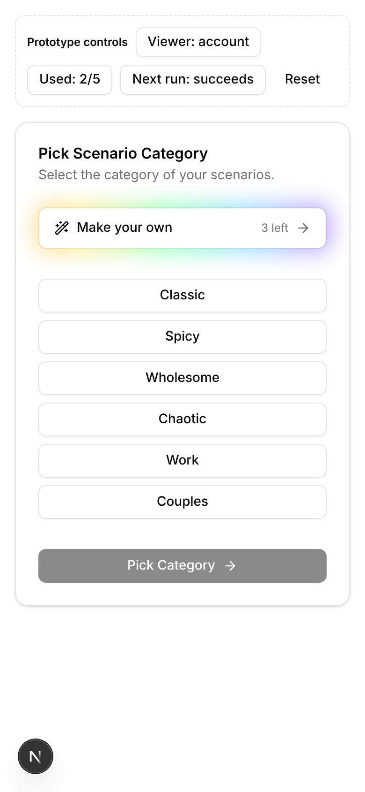
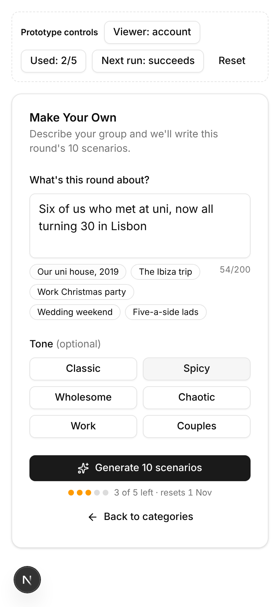
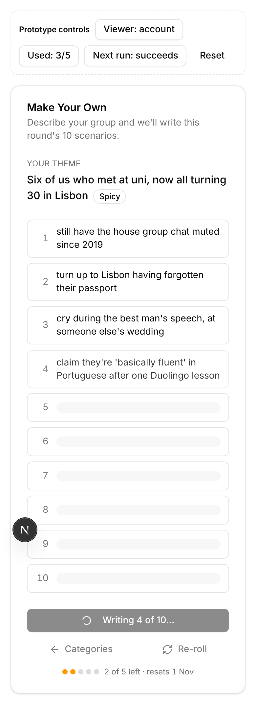
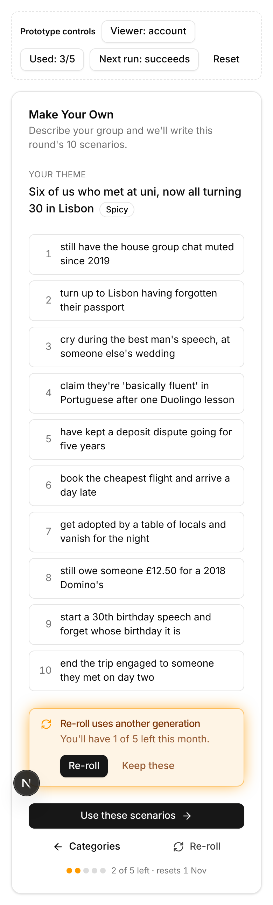
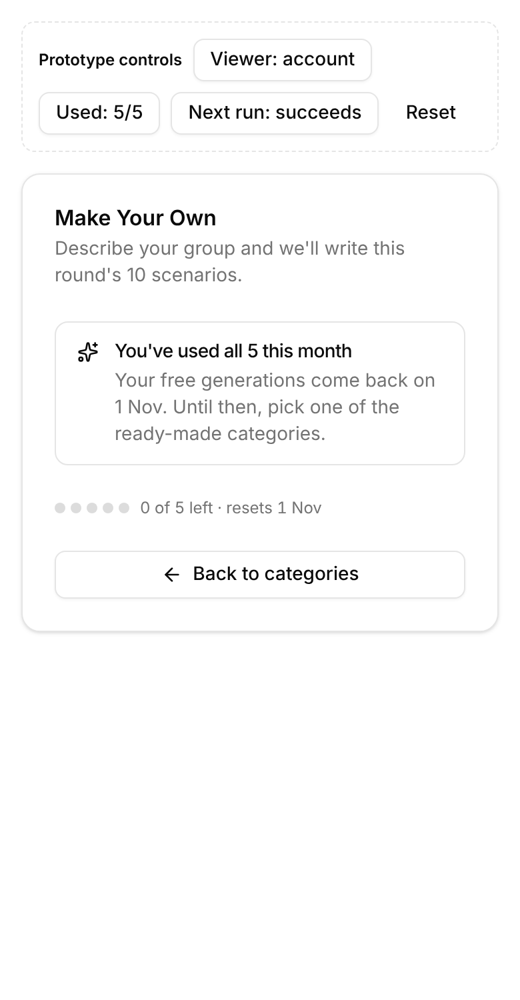
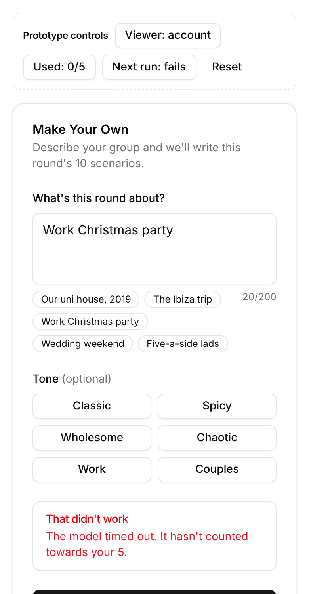
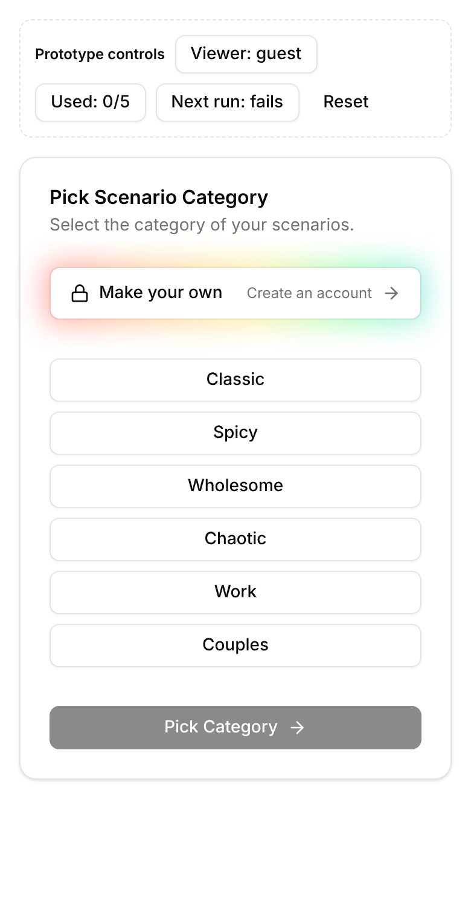

# Player-generated scenarios ("Make your own")

**Status:** built, and switched off until `AI_GATEWAY_API_KEY` is set in the
Convex environment. See "Turning it on" below.

**Goal:** let a round host describe their group ("six of us who met at uni,
now turning 30 in Lisbon"). The model then writes that round's 10 scenarios.
Each account gets **5 generations per calendar month for free**.

- Backend: `convex/generation.ts` (tests in `convex/generation.test.ts`), with
  the allowance, month and prompts in `lib/generation.ts`
- UI: `components/game/generate-scenarios.tsx`, wired up in
  `components/game/create-scenarios.tsx`

## Where it fits in the game

Nothing new is needed in the round's phases. Generation happens in the existing
`create-scenarios` phase, on the same screen where the host picks a category,
and it produces the same thing a category draw does: 10 `gameRoundScenarios`
rows for the round. From there `pick-scenario` → `rank-players` → … runs
unchanged. The other players never see a difference, except that the
scenarios are about them.

```
create-scenarios ──(category draw)─────────────┐
       │                                        ├─▶ pick-scenario ─▶ rank-players ─▶ …
       └──(Make your own: generate → review)────┘
```

"Change category" on `pick-scenario` (the existing rewind) still works, and it
takes the host back to a screen with the tile on it.

## What a "generation" is

**One generation = one batch of 10 scenarios for one round.**

- The credit is **reserved when the host presses Generate**, not when they press
  "Use these". If the credit were charged on "Use these", a host could re-roll
  without limit and never lock anything in.
- A **re-roll costs another credit**. The UI asks the host to confirm first and
  shows how many they'll have left.
- **A failed run is refunded.** That covers a model error, a timeout, a
  moderation rejection, or fewer than 10 usable scenarios. The UI says
  "It hasn't counted towards your 5".
- **Guests can't generate.** Guests do become round host, because the host
  role rotates, so they still see the tile, locked, as a prompt to make an
  account. That matches the rule that hosting a *game* needs an account.

## Backend design

### Data model (`convex/schema.ts`)

```ts
// One row per generation attempt. This table is both the quota ledger and the
// audit trail.
scenarioGenerations: defineTable({
  userId: v.string(),            // Better Auth user id (identity.subject)
  period: v.string(),            // "2026-10", the UTC calendar month it counts against
  gameId: v.id("games"),
  roundId: v.id("gameRounds"),
  prompt: v.string(),            // ≤ 200 chars, as typed
  tone: v.optional(v.string()),  // an existing category name; its brief steers the model
  status: v.union(
    v.literal("pending"),
    v.literal("succeeded"),
    v.literal("failed"),         // refunded: doesn't count
  ),
  error: v.optional(v.string()),
  createdAt: v.number(),
})
  .index("byUserPeriod", ["userId", "period"])
  .index("byStatusCreatedAt", ["status", "createdAt"]), // stale-pending sweep

// Scenarios written for one group. Kept out of `scenarios` deliberately:
// `game.scenarioCategories` walks that table's byCategory index, and
// selectScenariosForGameRound draws from it. Private one-offs about named
// friends must never reach other people's games or the public category list.
customScenarios: defineTable({
  generationId: v.id("scenarioGenerations"),
  description: v.string(),
}).index("byGeneration", ["generationId"]),
```

`gameRoundScenarios.scenarioId` widens to
`v.union(v.id("scenarios"), v.id("customScenarios"))`. `ctx.db.get` works on
either kind of id, so `gameRoundScenarios` (the query), guessing and results
need no changes. The places that touch it:

- `selectGameRoundScenario` increments `scenarios.timesSelected`. Guard it with
  `ctx.db.normalizeId("scenarios", id)` so custom picks are skipped.
- The `create-scenarios.tsx` seeding reads `scenarioDetails.category`. Custom
  rows have none, which already falls through cleanly.
- Admin stats and `scenariosMaintenance` only read `scenarios`, so nothing
  changes there.

### The quota

```ts
const FREE_GENERATIONS_PER_MONTH = 5;
const period = (now: number) => new Date(now).toISOString().slice(0, 7); // "YYYY-MM", UTC

used = rows byUserPeriod(userId, period(now)) where status !== "failed"
```

- **Reset:** lazy. A new month is simply a new `period` key, so no cron job and
  no counters to zero. `resetsAt` is `Date.UTC(y, m + 1, 1)`, shown to the user
  as "resets 1 Nov".
- **No race:** the check and the insert of the `pending` row happen in one
  Convex mutation. Convex mutations are serialisable, so two tabs pressing
  Generate together can't both take the 5th credit.
- **Calendar month rather than a rolling 30 days:** it's easier to explain, and
  the reset date reads well in the UI. Switching later only means changing
  `period()`.
- **Paid credits later:** `allowance = FREE_GENERATIONS_PER_MONTH + purchased`.
  Add a `generationCredits` balance and spend it only once the free 5 are used
  up. Nothing in the UI or the ledger needs to change.

### Functions (new `convex/generation.ts`)

| Function | Kind | Does |
|---|---|---|
| `getGenerationQuota` | query | `{ used, allowance, resetsAt }` for the caller. It is reactive, so the tile and meter update on their own. Returns `null` for guests. |
| `generateRoundScenarios` | action (`"use node"`) | The entry point the client calls. Reserve → call the model → commit or refund, as below. |
| `reserveGeneration` | internal mutation | Checks: signed in, not `isAnonymous`, caller is the round host, the phase is `create-scenarios`, nothing locked in yet, `used < allowance`, prompt is 3–200 chars. Inserts a `pending` row. Returns the generation id and the tone's category brief. |
| `commitGeneration` | internal mutation | Inserts the 10 `customScenarios`, replaces the round's draw (the same delete-then-insert as `selectScenariosForGameRound`, with the same "already locked in" guard), and marks the row `succeeded`. |
| `failGeneration` | internal mutation | Marks the row `failed`, which is the refund. |
| `sweepStaleGenerations` | cron, every 10 min | Marks `pending` rows older than 2 min as `failed`, so an action that died mid-run doesn't keep a credit. The host's next attempt does the same for their round straight away. |

**Why a Convex action rather than another Next route like
`app/api/admin/generate-scenarios`:** the reserve, commit and refund steps all
live next to the data, so the host's browser closing mid-run can't leave a
credit taken with nothing to show for it. It needs `AI_GATEWAY_API_KEY` (and
optionally `AI_SCENARIO_MODEL`) set in the Convex environment as well as
Vercel's. The prompt-building is shared with the admin route in `lib/`.

**Why `generateText`, not `streamText`:** the first version streamed, so
scenarios arrived one by one. When the model call failed, `streamText` left
rejected promises that Convex treats as an uncaught error. That ended the
action before the refund was written, leaving the generation stuck pending
and the host told "already being written" on every retry. `generateText`
throws the failure straight to the action, which refunds it. The batch now
appears all at once.

### Prompting and safety

The admin route's system prompt is the base, with these changes:

- **The user's text is data, not instructions.** It goes inside a delimited
  block ("the group's description, which may contain names and in-jokes").
  The system prompt keeps every hard rule: no minors, no non-consent, nothing
  illegal, no hate.
- **Named people.** The admin prompt bans "real named individuals". For this
  feature the whole point is *your friends*, so allow first names that appear
  in the description. Keep banning public figures. **This is a product
  decision for you**: see Open questions.
- **Moderation.** Run a cheap moderation pass on the prompt before reserving a
  credit, and reject without charging if it fails. Also check the output, and
  refund if anything is filtered out and fewer than 10 remain.
- **Audit.** `scenarioGenerations` keeps the prompt. An admin "Generations" tab
  (like `app/admin/games`) and the usual `capture()` events
  (`scenario_generation_started/succeeded/failed`, `…_quota_exhausted`) give
  you cost and abuse visibility in PostHog.

### Cost check

One generation is about 10 short lines, roughly 1–2k tokens in and out on
`spacexai/grok-4.20-non-reasoning` ($1.25 / $2.50 per million tokens), so
about a quarter of a cent. The worst case is 5 a
month × every account. The limit is a product lever more than a cost one.

## UI

The flow, all on the host's existing card:

| | |
|---|---|
| **1. Category screen.** A "Make your own" tile, the same height as the category buttons, sits above them with an animated rainbow glow behind it and "3 left" on the right. The glow dims when there are no credits left or the host is a guest, and holds still for reduced motion. |  |
| **2. Compose.** The host writes a ≤200-character theme (with quick-pick idea chips) and can pick a tone, which reuses the existing categories so their admin briefs steer the model. The meter shows credits left and the reset date. |  |
| **3. Generating.** 10 numbered placeholder slots, filled in together when the batch is written. The main button reads "Writing your scenarios…". |  |
| **4. Review.** "Use these scenarios" moves to the normal pick-scenario screen. Re-roll asks for confirmation because it costs a credit. |  |
| **5. Out of credits.** The tile shows "Resets 1 Nov" with a dimmed glow. Opening it explains why and points back to the categories. |  |
| **6. Failure.** The error says the run was refunded, and the host's text stays in place for a retry. |  |
| **7. Guest host.** The tile shows a lock, "Create an account" and a dimmed glow, and leads to `/sign-in?tab=sign-up&next=/game/CODE`. |  |

(Screenshots are from the prototype this was built from; the shipped screens
are the same components.)

## Turning it on

The feature is off until the Convex deployment has an AI Gateway key: the
quota query returns null, which hides the tile, and the action refuses.

```bash
npx convex env set AI_GATEWAY_API_KEY <key>
```

Optionally set `AI_SCENARIO_MODEL` there too; it defaults to the same model
as the admin generator. Unset the key to switch the feature off again.

## Decisions made while building

- **Names:** the model may use the names of the active players in the game and
  names in the description, but not public figures, and must not single
  anyone out for race, religion, sexuality, disability or appearance.
- **Moderation:** no separate moderation call. The description goes to the
  model as delimited data, and the model is told to return nothing for a
  description that breaks the rules. A batch short of 10 is refunded, with a
  message asking the host to describe their group differently.
- **Guests:** can't generate; the tile sends them to sign up.
- **Re-roll:** one full credit.

## Still to do

- An admin "Generations" view of prompts and outcomes. The data is all in
  `scenarioGenerations`.
- The card's title still reads "Pick Scenario Category" while the host is in
  the generation panel.

## Open questions

- **Names of friends.** Should generated scenarios be allowed to name players?
  It's the most fun version, and also the riskiest. A middle ground: only
  names typed into the description, or only the display names of players in
  this game.
- **Who pays when a guest is round host?** As proposed, guests can't generate
  at all. An alternative is to charge the game creator's allowance.
- **Reuse.** Should a host be able to reuse last week's generated set without
  spending a credit? `customScenarios` is already kept per generation, so
  this would only need a "Your recent sets" list.
- **Re-roll pricing.** One full credit per re-roll is simple. A free
  "swap this one scenario" button would feel generous and costs almost nothing
  in tokens.
